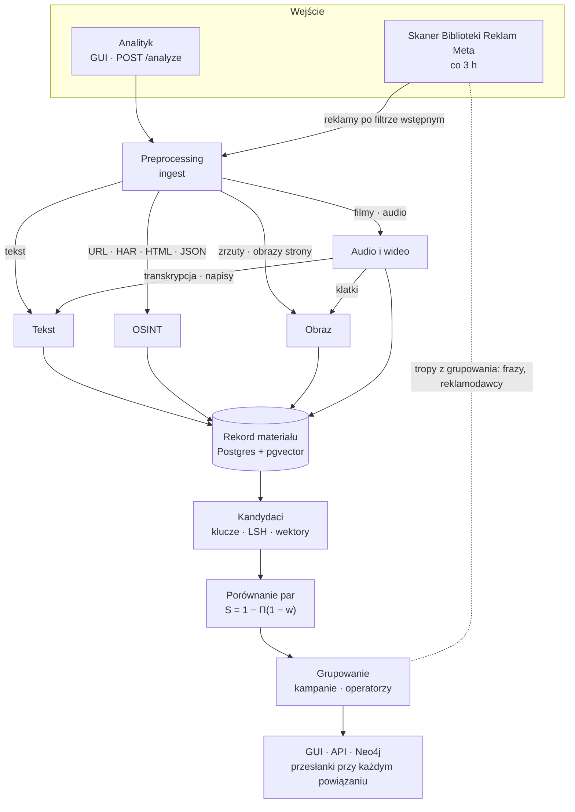
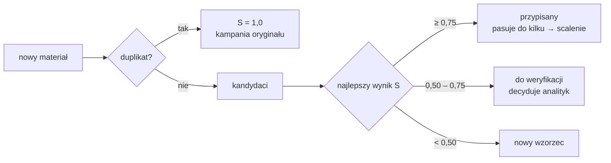
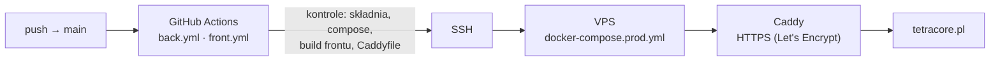

<div align="center">

# TETRA · FAKE-TRACE

**Kolekcjoner fejków – wykrywanie i grupowanie kampanii oszukańczych reklam**

HackNation 2026 · wyzwanie NASK „Follow the fake”

[](https://tetracore.pl)
[](https://tetracore.pl/api/docs)


</div>

> [!TIP]
> **Wersja online działa bez instalacji i bez logowania: [tetracore.pl](https://tetracore.pl)**
> · dokumentacja API: [tetracore.pl/api/docs](https://tetracore.pl/api/docs)
> · na serwerze co 3 h działa też skaner Biblioteki Reklam Meta.
> Wersja online to ten sam kod co w tym repozytorium – każdy push do `main` wdraża się automatycznie ([Wdrożenie i CI/CD](#13-wdrożenie-i-cicd)).

TETRA przyjmuje podejrzaną reklamę w dowolnej postaci – link, zrzut ekranu, film, zapis strony (HTML, HAR),
tekst, archiwum albo cały folder przypadku – i odpowiada na trzy pytania:

1. **Do której kampanii oszustów należy** – albo czy to **nowy wzorzec**.
2. **Dlaczego** – przy każdym połączeniu są przesłanki zdaniami i wkład każdego modułu.
3. **Kto za nią stoi** – kampanie tego samego **operatora**, czyli ze wspólną infrastrukturą (piksel, konto reklamowe, kit, serwer).

Skaner Biblioteki Reklam Meta sam wyszukuje nowe podejrzane reklamy i przepuszcza je przez ten sam proces.

<table>
<tr>
<td align="center"><b>4</b><br><sub>moduły cech: tekst, OSINT, obraz, audio i wideo</sub></td>
<td align="center"><b>~70</b><br><sub>rodzajów śladów infrastruktury</sub></td>
<td align="center"><b>100%</b><br><sub>F1 par na etykietach paczki NASK</sub></td>
<td align="center"><b>10/10 · 15/15</b><br><sub>nowe warianty przypisane · nowe kampanie odrzucone</sub></td>
<td align="center"><b>1 komenda</b><br><sub><code>docker compose up -d</code></sub></td>
</tr>
</table>

## Spis treści

1. [Demo online](#1-demo-online)
2. [Szybki start (lokalnie)](#2-szybki-start-lokalnie)
3. [Tryb deweloperski](#3-tryb-deweloperski)
4. [Architektura – przepływ całej aplikacji](#4-architektura--przepływ-całej-aplikacji)
5. [Preprocessing – dowolne wejście](#5-preprocessing--dowolne-wejście)
6. [Moduły cech](#6-moduły-cech) – [tekst](#61-tekst) · [OSINT](#62-osint--infrastruktura) · [obraz](#63-obraz) · [audio i wideo](#64-audio-i-wideo)
7. [Rekord materiału i kandydaci](#7-rekord-materiału-i-kandydaci)
8. [Podobieństwo i grupowanie](#8-podobieństwo-i-grupowanie)
9. [Interfejs i wyjaśnialność](#9-interfejs-i-wyjaśnialność)
10. [Skaner Biblioteki Reklam Meta](#10-skaner-biblioteki-reklam-meta)
11. [Wyniki i ewaluacja](#11-wyniki-i-ewaluacja)
12. [Kryteria oceny – gdzie w projekcie](#12-kryteria-oceny--gdzie-w-projekcie)
13. [Wdrożenie i CI/CD](#13-wdrożenie-i-cicd)
14. [API](#14-api)
15. [Narzędzia wiersza poleceń](#15-narzędzia-wiersza-poleceń)
16. [Konfiguracja](#16-konfiguracja)
17. [Struktura repozytorium](#17-struktura-repozytorium)
18. [Technologie i licencje](#18-technologie-i-licencje)
19. [Dokumentacja](#19-dokumentacja)
20. [Rozwiązywanie problemów](#20-rozwiązywanie-problemów)
21. [Bezpieczeństwo i dane](#21-bezpieczeństwo-i-dane)

---

## 1. Demo online

| Co | Adres |
|---|---|
| GUI – analiza materiału, kampanie, grafy 2D/3D, operatorzy | **https://tetracore.pl** |
| API (OpenAPI / Swagger) | https://tetracore.pl/api/docs |
| Statystyki bazy | https://tetracore.pl/api/stats |

Do sprawdzenia działania nie jest potrzebny żaden klucz ani konto. Na stronie głównej wklej link lub tekst
reklamy albo dodaj pliki (zrzut, film, HTML, HAR, ZIP) i kliknij **Szukaj**.

## 2. Szybki start (lokalnie)

**Wymagania:** Docker Desktop (Windows / macOS) albo Docker Engine z Compose ≥ 2.20 (Linux), 8 GB RAM dla
Dockera (zalecane 12–16 GB), 25 GB miejsca, internet przy pierwszym starcie. GPU niepotrzebne. Nie trzeba
instalować Pythona, Node.js ani bazy danych.

```bash
git clone <adres repozytorium> tetra
cd tetra
docker compose up -d
```

Otwórz **http://localhost:8080**. Plik `.env` jest opcjonalny – wszystko ma wartości domyślne.

Pierwszy start buduje obraz z modelami ML i pobiera modele (ok. 20–40 min, zależnie od łącza). Kolejne
starty trwają kilkanaście sekund.

```bash
docker compose logs -f init     # schemat bazy i modele – na końcu „System gotowy”
docker compose logs -f seed     # wczytywanie paczki NASK (jeśli jest w data/)
docker compose ps               # init i seed kończą się statusem „Exited (0)”
```

| Usługa | Rola | Adres |
|---|---|---|
| **web** | front (GUI) serwowany przez Caddy; `/api/*` → api | **http://localhost:8080** |
| **api** | FastAPI – analiza materiałów, kampanie, graf, skaner | http://localhost:8000/docs |
| **init** | jednorazowo przy starcie: schemat bazy, modele, baza twarzy | – |
| **seed** | jednorazowo: wczytuje `data/BACKUP` i `data/DANE` do pustej bazy | – |
| **scheduler** | skaner Biblioteki Reklam Meta co 3 h (wymaga `META_ACCESS_TOKEN`) | – |
| **postgres** | PostgreSQL 16 + pgvector – rekordy, wektory, kampanie | `localhost:5432` (fake / fake) |
| **neo4j** | kopia grafu powiązań do przeglądania | http://localhost:7474 (neo4j / fakecollector) |
| **app** | ten sam obraz z JupyterLab – narzędzia wiersza poleceń | http://localhost:8888 (token `fake`) |

**Paczka organizatora (opcjonalnie).** Dane NASK nie są w repozytorium (regulamin zakazuje ich
rozpowszechniania). Rozpakuj paczkę **przed** pierwszym startem tak, by powstały `data/BACKUP/p1…p15` i
`data/DANE/…` – usługa `seed` wczyta ją sama (15–25 min). Archiwum jest szyfrowane (7-Zip), a folder
projektu dodaj do wyjątków antywirusa – antywirusy usuwają zapisane strony scamów.

Pełna instrukcja (konfiguracja, token Meta, baza twarzy, czysta baza, GPU): [`docs/INSTALACJA.pdf`](docs/INSTALACJA.pdf).

## 3. Tryb deweloperski

```bash
docker compose up -d              # backend: kod z src/, config/, scripts/ jest zamontowany, API przeładowuje się samo
docker compose logs -f api        # logi API
docker compose build app web      # po zmianie requirements.txt, Dockerfile albo frontu

cd front && npm install && npm run dev     # front z hot reload: http://localhost:5173 → API http://localhost:8000
```

- Front deweloperski czyta adres API z `VITE_API_URL` (domyślnie `http://localhost:8000`); `CORS_ORIGINS` w `.env` już obejmuje port 5173.
- Biblioteka doinstalowana ręcznie (`pip install` w kontenerze) znika przy odtworzeniu kontenera – dopisz ją do `requirements.txt`.
- Testy: `docker compose exec app pytest` (testy jednostkowe) i `docker compose exec app python scripts/smoke_test.py [--fast]` (cały potok).
- Czysta baza: `docker compose down && docker volume rm fakecollector_pgdata fakecollector_neo4jdata && docker compose up -d` (modele zostają w wolumenie `models`).

## 4. Architektura – przepływ całej aplikacji



| Etap | Kod | Wynik |
|---|---|---|
| Preprocessing | [`src/fakecollector/ingest/`](src/fakecollector/ingest/) | `Incident`: składniki dla modułów, braki, odcisk duplikatu |
| Moduły cech | [`src/fakecollector/features/`](src/fakecollector/features/) | cechy, wektory i przesłanki każdego modułu |
| Rekord | [`src/fakecollector/record/`](src/fakecollector/record/) | podsumowanie, pełne cechy (JSONB), wektory, klucze wyszukiwania |
| Grupowanie | [`src/fakecollector/grouping/`](src/fakecollector/grouping/) | pary z wynikiem i przesłankami, kampanie, operatorzy, decyzje analityka |
| Graf | [`src/fakecollector/graph/`](src/fakecollector/graph/) | węzły i krawędzie dla frontu, kopia w Neo4j |
| Skaner | [`src/fakecollector/adlib/`](src/fakecollector/adlib/) | harmonogram, zapytania, filtr wstępny, tropy |
| Ewaluacja | [`src/fakecollector/eval/`](src/fakecollector/eval/) | metryki par, ARI, „wyjmij jeden / kampanię”, ablacja, progi |
| API | [`src/fakecollector/api/main.py`](src/fakecollector/api/main.py) | FastAPI, 16 endpointów |
| Front | [`front/`](front/) | React 18 + Vite, grafy react-force-graph 2D/3D, styl szkicu (Rough.js) |

## 5. Preprocessing – dowolne wejście

[`src/fakecollector/ingest/`](src/fakecollector/ingest/) rozpoznaje wejście, rozkłada je na składniki i kieruje
każdy składnik do modułu, który umie go przeanalizować. Folder z HAR-em, zrzutem i filmem zasila naraz
wszystkie cztery moduły.

| Wejście | Jak jest obsłużone |
|---|---|
| URL | otwierany **wyłącznie w kontenerze** (Playwright/Chromium z mobilnym user-agentem aplikacji Facebooka, HTTPX jako zapas); zapis HTML, HAR, zrzutu i łańcucha przekierowań; adresy sieci prywatnej zablokowane (SSRF) |
| tekst (SMS, treść reklamy, e-mail) | wprost do modułu tekstu; linki z tekstu do OSINT |
| zrzut ekranu | OCR (tesseract pol+eng) do tekstu, obraz do modułu obrazu, adresy z OCR do OSINT |
| HAR (log komunikacji), HTML, MHTML | główny dokument, przekierowania, zasoby, skrypty → OSINT i tekst |
| film, audio | ffmpeg: dźwięk 16 kHz, klatki; strumienie HLS (`.m3u8` + `.ts`) sklejane w jeden plik |
| JSON z metadanymi, ZIP, folder przypadku | rozpakowanie i rozpoznanie każdego pliku po rozszerzeniu i zawartości |

- **Wybór tekstu według wiarygodności:** tekst wpisany > treść strony (HTML > tekst strony > HAR) > reklama z Biblioteki > JSON > transkrypcja > OCR; źródło krótsze niż 15 słów ustępuje następnemu.
- **Strony błędów** (502, „domain for sale”, Cloudflare challenge) nie zastępują zapisanych materiałów – status `dead`, analiza idzie dalej.
- **Duplikaty:** odcisk wejścia (hash znormalizowanego tekstu, plików i adresu bez `utm_*`, `fbclid`…) → wynik 1,0 z oryginałem.
- **Braki** (`missing`) – np. „strona nie działa”, „brak nagrań” – są zapisywane i pokazywane w GUI.

Szczegóły: [`src/fakecollector/ingest/README.md`](src/fakecollector/ingest/README.md).

## 6. Moduły cech

Każdy moduł zwraca cechy, wynik porównania 0–1, pewność 0–1 i **przesłanki zdaniami**. Moduł bez danych nic
nie zwraca – brak nie obniża wyniku pary.

### 6.1 Tekst

[`src/fakecollector/features/text/`](src/fakecollector/features/text/) · ta sama historia, inna twarz

| Cecha | Jak | Dlaczego |
|---|---|---|
| szkielet tekstu | osoby, marki, kwoty, daty, adresy, telefony → `<OSOBA>`, `<KWOTA>`… | oszuści podmieniają celebrytę i kwotę, szablon artykułu zostaje |
| MinHash tekstu i szkieletu | 128 permutacji, shingle 5-wyrazowe, LSH 32 × 4 | kopie i wspólne fragmenty, odporne na przestawienia; działa bez modelu |
| embeddingi | `paraphrase-multilingual-MiniLM-L12-v2` (384 wym.) | parafrazy i przepisane wersje |
| narracja | 6 kategorii (inwestycja, skandal, cudowny lek, sklep, hazard, inne): zero-shot + słowa-wskazówki | tematyka kampanii |
| osoby, marki | słowniki z odmianą nazwisk | **tylko przesłanka** – celebryci są wspólni dla wielu kampanii |
| perswazja | 6 grup: zysk, pilność, autorytet, tajemnica, sensacja, dowód społeczny | profil manipulacji |
| kwoty, linki, e-maile, telefony | wyrażenia regularne | kontakty i obietnice |

Wynik: średnia ważona dostępnych sygnałów (MinHash tekstu 0,30, szkieletu 0,25, kosinus szkieletu 0,20,
tekstu 0,15, słowa kluczowe 0,05, narracja 0,05; identyczny hash = 1,0). Pewność zależy od źródła tekstu
(HTML 1,0, transkrypcja 0,8, OCR 0,6 × jakość). Szczegóły: [`features/text/README.md`](src/fakecollector/features/text/README.md).

### 6.2 OSINT – infrastruktura

[`src/fakecollector/features/osint/`](src/fakecollector/features/osint/) · ślady, których operator nie zmienia między domenami

Z HAR, HTML i zapytań na żywo moduł wyciąga **pivoty** – znormalizowane pary (rodzaj, wartość) z wagą
aprioryczną; razem 70 rodzajów w 5 zakresach:

| Zakres | Przykłady (waga) | Poziom |
|---|---|---|
| identity | domena rejestrowalna (1,0), host strony docelowej (0,9), ID reklamy Meta (1,0) | kampania |
| operator | Pixel Meta (0,95), GA4 / GTM (0,9), token weryfikacji domeny Meta (0,95), telefon, e-mail, Telegram (0,9), portfel krypto (1,0) | operator |
| kit | katalog wdrożenia kitu (0,9), własny JS (0,85), endpoint API (0,75), host aktora (0,8), favicona (0,7) | operator |
| infra | certyfikat TLS (0,95), domeny w jednym certyfikacie (0,9), IP poza CDN (0,6), NS, MX, partia rejestracji | operator |
| behavior | rodzina TDS, zestaw bibliotek, generator strony (0,02–0,4) | operator (słabe) |

- **Wzbogacenie** (16 wątków, budżet 45 s, cache 24 h): DNS, RDAP/WHOIS, IP → ASN, certyfikat TLS, Certificate Transparency (crt.sh), favicona (hash Shodana). Bez kluczy API.
- **Ochrona przed szumem:** zasoby skopiowane z podszywanego serwisu (skrypty Facebooka, favicona Gazeta.pl) są oznaczane jako „vendor”; wkład pivotu mnoży rzadkość wartości w bazie (IDF), więc IP Cloudflare'a samo się wygasza.

### 6.3 Obraz

[`src/fakecollector/features/image/`](src/fakecollector/features/image/) · kto, co i w jakim szablonie

| Cecha | Jak | Siła dowodu |
|---|---|---|
| identyczny plik, ta sama kreacja | SHA-256; pHash i dHash obrazu i środka (`T_p = 4`, `T_d = 14` bitów – kalibracja na 3570 parach) | silny |
| ten sam kadr | punkty ORB + homografia RANSAC – wycięty fragment, zrzut z telefonu | silny |
| ta sama twarz | detekcja SCRFD / YuNet, wektory ArcFace (buffalo_l) i SFace – dwa modele głosują; jakość MagFace | silny |
| kod QR | odczyt z powiększeniem 2× i 3× | silny |
| podobny wygląd | embedding **CLIP ViT-B-32**, kosinus ≥ 0,68 | średni |
| elementy szablonu | wycinki (rogi, pasek) oceniane opisami, ≥ 2 wspólne elementy | średni |
| znana osoba, logo | baza referencyjna osób; logo przez **SigLIP 2** i wzorce | słaby |
| deepfake | facetorch (EfficientNet) – tylko informacja | nie łączy |

**Identyfikacja osób z małej bazy referencyjnej:** `data/reference_people/<osoba>/` – kilka zdjęć na osobę
i `zrodla.json` z licencjami. Osoba jest rozpoznana przy kosinusie ≥ 0,3894 i marginesie 0,21 nad drugą
osobą (próg z testu „wyjmij jedno”); słaba jakość twarzy → brak zamiast zgadywania. Wszystkie progi z opisem
źródła: [`config/obraz.toml`](config/obraz.toml).

### 6.4 Audio i wideo

[`src/fakecollector/features/av/`](src/fakecollector/features/av/) · przetrwa przycięcie, kompresję i szum

| Cecha | Jak | Dlaczego |
|---|---|---|
| odcisk dźwięku | pary szczytów widma (metoda Shazama), ≥ 12 zgodnych par | ta sama ścieżka mimo wycięcia, MP3, szumu |
| odcisk głosu | SpeechBrain ECAPA-TDNN (192 wym.) z 3-sekundowych fragmentów mowy | ten sam lektor albo sklonowany głos (≥ 0,75) |
| odcisk obrazu filmu | dHash 64 bity, 2 klatki/s, Hamming ≤ 10 | te same ujęcia po przeskalowaniu |
| transkrypcja | Whisper small | treść mowy trafia do modułu tekstu |
| napisy z ekranu | OCR 6 klatek | adresy i obietnice wypisane w filmie |
| klatki | do 12 klatek na film → moduł obrazu | twarze i logo w reklamie wideo |

`av_score` = najmocniejszy z sygnałów dźwięk / obraz / głos. Pomiar: przycięta, pomniejszona i przekodowana
kopia filmu – 1,0; inny film – 0,0. Szczegóły: [`features/av/README.md`](src/fakecollector/features/av/README.md).

## 7. Rekord materiału i kandydaci

Każdy materiał to rekord w PostgreSQL + pgvector: `materials` (podsumowanie, status, braki, kampania, decyzja
analityka), `material_features` (pełne cechy, JSONB), `material_vectors` (tekst, szkielet, CLIP/SigLIP, twarze,
głos) i `material_keys` (klucze wyszukiwania).

**Kandydaci do porównania** – materiały, które mają wspólny klucz (hash tekstu, pasmo LSH, domena, piksel,
hash obrazu, QR), obraz w odległości pHash ≤ 8, ≥ 15 wspólnych hashy dźwięku albo są najbliżej w przestrzeni
wektorów (`<=>` w pgvector). Nie porównujemy każdej pary w bazie, a i tak nie gubimy wariantów z innej domeny.

## 8. Podobieństwo i grupowanie

Łączenie wyników modułów jest jawne i wyjaśnialne ([`grouping/compare.py`](src/fakecollector/grouping/compare.py)):

```
s′ = max(0, (s − szum) / (1 − szum))     wynik poniżej progu szumu modułu nic nie wnosi
w  = rzetelność × pewność × s′           wkład modułu
S  = 1 − Π(1 − w)                        jeden pewny dowód wystarcza, kilka średnich się wzmacnia
```

| Moduł | Rzetelność | Próg szumu | Do kampanii | Do operatora |
|---|---|---|---|---|
| tekst | 1,00 | 0,25 | cały wynik | – |
| OSINT | 1,00 | 0,30 | tylko `identity` (ta sama domena, ta sama reklama) | operator, kit, infra, behavior |
| audio i wideo | 0,95 | 0,30 | cały wynik | – |
| obraz | 0,90 | 0,40 | kreacje, zrzuty, klatki, twarz lektora | wspólne obrazy zasobów stron |



- **Dwa poziomy.** *Kampania* = ta sama treść (spójne składowe grafu par ≥ 0,75). *Operator* = grupa podobnych kampanii ze wspólną infrastrukturą (`S_op ≥ 0,75`); operator łączy kampanie, ale ich nie scala.
- **Ślady wszechobecne** – kopiowane z podszywanego serwisu i obecne w > 30% bazy – nie łączą; identyfikatory kont (Pixel, GA4, GTM), kit i certyfikaty łączą zawsze.
- **Decyzje analityka** (potwierdź / odrzuć / cofnij) dotyczą par materiałów i przetrwają przeliczenie (`python -m fakecollector.grouping rebuild`).

Pełny opis z progami i ich źródłami: [`docs/METODYKA.pdf`](docs/METODYKA.pdf).

## 9. Interfejs i wyjaśnialność

| Widok | Co pokazuje |
|---|---|
| **Analiza** (strona główna) | tekst, link i dowolne pliki naraz; wynik *pasuje do kampanii* / *do weryfikacji* / *nowy wzorzec* z wynikiem i przesłankami; cechy z modułów, braki |
| **Przegląd kampanii** | kartoteka z wyszukiwarką (osoba, domena, marka), mapa wszystkich kampanii jako graf 2D (szkic) albo 3D, nowe reklamy ze skanera |
| **Kampania** | materiały z miniaturami, graf powiązań, panel **„Dlaczego połączone?”** z wkładem modułów dla wybranej krawędzi, najmocniejsze powiązania, ten sam operator |
| **Operator** | kampanie o różnej treści ze wspólną infrastrukturą i ślady, które je łączą |
| **Materiał** | cechy, zrzuty i klatki, tekst, otoczenie w grafie, decyzja analityka |
| **Neo4j Browser** | ten sam graf do zapytań Cypher, np. `MATCH (o:Operator)<-[:OPERATOR]-(k:Kampania) RETURN o, k` |

Przykład przesłanek pary: *„tekst: 87% wspólnych fragmentów tekstu”*, *„obraz: ta sama kreacja (silny)”*,
*„infrastruktura: ten sam Pixel Meta”*.

## 10. Skaner Biblioteki Reklam Meta

[`src/fakecollector/adlib/`](src/fakecollector/adlib/) – punkty dodatkowe z zadania (automatyczne wyszukiwanie
i okresowa aktualizacja):

- **Harmonogram:** skan co 3 h (reklamy scamowe żyją 0–3 dni), okno 3 dni wstecz, raz na dobę sprawdzenie, czy Meta zdjęła przeanalizowane reklamy.
- **Zapytania:** frazy typowe dla oszustw, frazy z wcześniejszych trafień i reklamy stron-reklamodawców już oznaczonych jako podejrzane.
- **Filtr wstępny:** `1 − Π(1 − waga)` po sygnałach – domena na Liście Ostrzeżeń CERT Polska 0,6, znana osoba + narracja scamowa 0,45, płatnik, strona udająca media…; próg 0,5, najwyżej 20 reklam na skan.
- **Pełna analiza** tym samym `POST /analyze` co zgłoszenie od człowieka.

Skan na żywo 22.11.2026: **1001 reklam → 984 odrzucone przez filtr → 17 przeanalizowanych.** Progi: [`config/adlib.toml`](config/adlib.toml).

## 11. Wyniki i ewaluacja

**Paczka NASK (25 materiałów):** 18 kampanii, w tym 3 wieloelementowe, i 2 operatorów:

- **Operator A** – fałszywe artykuły z celebrytami (7 kampanii): wspólny Pixel Meta, host aktora, kit i grafiki; kampania Brzoski to 6 materiałów na 6 domenach, sklejonych szkieletem tekstu i kreacjami.
- **Operator B** – suplementy i cudowne leki (4 kampanie): wspólny kit i szablon „wideo + fałszywe komentarze + licznik zapasów”.

**Ewaluacja** (`python -m fakecollector.eval run`, etykiety przejrzane ręcznie, 300 par):

| Miara | Wynik |
|---|---|
| precyzja / czułość / F1 par | 100% / 100% / 100% (17 dobrych par, 0 błędnych) |
| nowy wariant znanej kampanii trafia do niej („wyjmij jeden”) | 10/10 |
| materiał z nowej kampanii dostaje „nowy wzorzec” | 15/15 |
| nieznana kampania nie dokleja się do innych („wyjmij kampanię”) | 100% |
| ARI · F1 poziomu operatora | 1,0 · 100% |
| zakres progów z identycznym wynikiem | 0,50–0,85 (wybrany 0,75 – środek przedziału) |
| ablacja: sam tekst / sam obraz / sam OSINT (F1) | 100% / 94% / 11% |

Zbiór jest mały (3 kampanie wieloelementowe) – to sprawdzian metody, nie dowód skuteczności na dużą skalę.
Opis kampanii, wzorców i źródeł metadanych: [`docs/KAMPANIE.pdf`](docs/KAMPANIE.pdf).

## 12. Kryteria oceny – gdzie w projekcie

| Kryterium | Waga | Jak je realizujemy |
|---|---|---|
| **A. Jakość korelacji i grupowania** | 30% | wyjaśnialne łączenie `S = 1 − Π(1 − w)` z progami szumu; kampanie i operatorzy (grupy kampanii); przypisanie przyrostowe, *nowy wzorzec*, duplikaty = 1,0; ewaluacja „wyjmij jeden / kampanię”, przegląd progów ([§8](#8-podobieństwo-i-grupowanie), [§11](#11-wyniki-i-ewaluacja)) |
| **B. Cechy i źródła danych** | 30% | tekst, narracja, szkielet, embeddingi; wizerunki, logo, szablon, QR; ~70 śladów infrastruktury z DNS / RDAP / TLS / CT; głos i odciski nagrań; wektory w pgvector; identyfikacja osób z małej bazy referencyjnej ([§6](#6-moduły-cech), [§7](#7-rekord-materiału-i-kandydaci)) |
| **C. Demonstrator end-to-end** | 15% | GUI lokalnie i online; URL, zrzut, HAR, film, HTML, JSON, ZIP, folder przypadku; braki i martwe strony obsłużone; nowy materiał porównywany z bazą ([§5](#5-preprocessing--dowolne-wejście), [§9](#9-interfejs-i-wyjaśnialność)) |
| **D. Czytelność i interpretowalność** | 15% | kampanie, operatorzy, grafy 2D/3D, Neo4j; przesłanki i wkład modułów przy każdej krawędzi ([§9](#9-interfejs-i-wyjaśnialność)) |
| **E. Wdrożenie, skalowalność, przenośność** | 10% | jedna komenda Docker Compose, wersja online z HTTPS, CI/CD, instrukcja, lista zależności z licencjami, dostęp do API bez kluczy ([§2](#2-szybki-start-lokalnie), [§13](#13-wdrożenie-i-cicd), [§18](#18-technologie-i-licencje)) |

Wymagania formalne: GUI ✓ · opis metodyki ([`METODYKA.pdf`](docs/METODYKA.pdf)) ✓ · instrukcja instalacji ([`INSTALACJA.pdf`](docs/INSTALACJA.pdf)) ✓ · kod w Git ✓ · biblioteki, modele i usługi z licencjami ([`LICENCJE.pdf`](docs/LICENCJE.pdf)) ✓ · kontener ✓.

## 13. Wdrożenie i CI/CD



- [`docker-compose.prod.yml`](docker-compose.prod.yml): `postgres`, `neo4j`, `api` (pod `/api`), `scheduler`, `web` (Caddy z automatycznym certyfikatem dla `DOMAIN`). Na zewnątrz wystawione są tylko porty 80 i 443.
- [`back.yml`](.github/workflows/back.yml) – zmiany w `src/`, `config/`, `scripts/`: kontrola składni i compose, potem `docker compose up -d --build api scheduler` na serwerze.
- [`front.yml`](.github/workflows/front.yml) – zmiany w `front/`: build frontu i walidacja Caddyfile, potem `docker compose up -d --build --no-deps web`.
- Oba workflowy mają wspólną grupę `concurrency`, więc wdrożenia się nie nakładają. Ustawienia repozytorium: zmienne `VPS_HOST`, `VPS_USER`, sekrety `VPS_SSH_KEY`, `VPS_KNOWN_HOSTS`.
- Serwer demo: VPS 6 vCPU, 12 GB RAM, wszystkie modele na CPU.

Własny serwer: [`docs/INSTALACJA.pdf`](docs/INSTALACJA.pdf), sekcja 08.

## 14. API

Dokumentacja interaktywna: http://localhost:8000/docs · online: https://tetracore.pl/api/docs

| Endpoint | Zwraca |
|---|---|
| `POST /analyze` (multipart: `text`, `files`) | pełna analiza i zapis; `assignment` (kampania, status, wynik, przesłanki), cechy modułów |
| `GET /stats` | liczby: materiały, kampanie, operatorzy, do weryfikacji |
| `GET /campaigns`, `GET /campaigns/{id}` | kampanie; szczegóły z materiałami, powiązaniami i operatorem |
| `GET /materials/{id}` | rekord materiału (bez wektorów) |
| `GET /materials/{id}/images`, `GET /materials/{id}/images/{n}` | zrzuty i klatki materiału |
| `POST /materials/{id}/decision` | decyzja analityka: `potwierdz` / `odrzuc` / `cofnij` |
| `GET /graph` (`?campaign_id=`, `?operator=`, `?material_id=`) | graf `{nodes, edges, stats, legend}` |
| `GET /compare?a=&b=` | porównanie dwóch materiałów wszystkimi modułami, z przesłankami |
| `GET /adlib/status`, `GET /adlib/ads` | stan skanera i znalezione reklamy |
| `POST /text/analyze`, `/image/analyze`, `/image/compare`, `/av/compare` | pojedyncze moduły |

`POST /analyze` trwa od kilku sekund (tekst) do 1–2 minut (film z transkrypcją). Przełączniki formularza:
`fetch`, `osint`, `av`, `asr`, `image`, `save`, `group`.

## 15. Narzędzia wiersza poleceń

Uruchamiane w kontenerze, np. `docker compose exec api <polecenie>`:

```bash
python -m fakecollector.record add data/MOJ_FOLDER                  # analiza i zapis materiałów (plik, folder, zbiór)
python -m fakecollector.record list | show <id> | candidates <id> | delete <id>
python -m fakecollector.grouping rebuild                            # kampanie od nowa dla całej bazy
python -m fakecollector.grouping campaigns | show <nr> | compare <id_a> <id_b>
python -m fakecollector.graph stats | export data/graf.json | sync  # graf; sync = kopia w Neo4j
python -m fakecollector.eval labels | run [--fresh] | show          # ewaluacja (data/labels.csv)
python -m fakecollector.adlib --raz | --ponow                       # skan Biblioteki Reklam teraz / ponowna analiza
python -m fakecollector.ingest data/DANE/47 --no-fetch              # sam preprocessing
python -m fakecollector.features.text data/BACKUP/p3 data/BACKUP/p4 --compare
python -m fakecollector.features.av data/DANE/5 data/DANE/14 --compare
python scripts/smoke_test.py [--fast] [--enrich]                    # test całego potoku
```

## 16. Konfiguracja

Wszystko ma wartości domyślne; zmiany w `.env` (wzór: [`.env.example`](.env.example)).

| Zmienna | Domyślnie | Opis |
|---|---|---|
| `WEB_PORT`, `API_PORT` | 8080, 8000 | porty frontu i API |
| `META_ACCESS_TOKEN` | pusty | token Meta Ad Library API – bez niego nie działa tylko skaner |
| `ADLIB_TRYB` | `na_zywo` | `odtwarzanie` = zapisane odpowiedzi API, bez sieci i tokenu |
| `IMAGE_MODELS` | wszystkie | modele obrazu pobierane przez `init` |
| `PRELOAD_MODELS` | 1 | modele tekstu i audio pobierane przy starcie (0 = przy pierwszej analizie) |
| `SEED_DIRS`, `SEED_ASR` | `data/BACKUP data/DANE`, 1 | co wczytuje `seed` i czy z transkrypcją |
| `TORCH_INDEX` | CPU | źródło PyTorcha (GPU: `docker-compose.gpu.yml`) |

Progi modułów z opisem źródła każdej wartości: [`config/obraz.toml`](config/obraz.toml), [`config/adlib.toml`](config/adlib.toml); wagi i progi grupowania: [`grouping/compare.py`](src/fakecollector/grouping/compare.py) (uzasadnienie w [`docs/METODYKA.pdf`](docs/METODYKA.pdf)).
Pełna lista zmiennych: [`docs/INSTALACJA.pdf`](docs/INSTALACJA.pdf).

## 17. Struktura repozytorium

```
├── src/fakecollector/
│   ├── ingest/               preprocessing: rozpoznanie wejścia, pobranie strony, składniki, duplikaty
│   ├── features/
│   │   ├── text/             moduł tekstu (+ słowniki osób i marek)
│   │   ├── osint/            moduł infrastruktury: capture, ekstrakcja, wzbogacenie, pivoty
│   │   ├── image/            moduł obrazu: hashe, CLIP/SigLIP 2, twarze, logo, QR
│   │   └── av/               moduł audio i wideo
│   ├── record/               rekord materiału, Postgres + pgvector, kandydaci
│   ├── grouping/             porównanie par, kampanie, operatorzy, decyzje analityka
│   ├── graph/                graf dla frontu i kopia w Neo4j
│   ├── adlib/                skaner Biblioteki Reklam Meta
│   ├── eval/                 ewaluacja
│   ├── api/                  FastAPI
│   └── bootstrap.py          usługi init (schemat, modele) i seed (dane)
├── front/                    GUI: React + Vite (pages/, components/, graph/)
├── config/                   progi modułu obrazu i skanera
├── deploy/                   obraz frontu (Caddy) i Caddyfile (lokalny i serwerowy)
├── db/init.sql               rozszerzenia bazy (tabele tworzy kod)
├── docs/                     dokumentacja PDF
├── scripts/                  smoke test, narzędzia modułu obrazu
├── tests/                    testy jednostkowe (pytest)
├── .github/workflows/        CI/CD: back.yml, front.yml
├── docker-compose.yml        system lokalny (dev / demo)
├── docker-compose.prod.yml   serwer (HTTPS)
├── docker-compose.gpu.yml    opcjonalnie NVIDIA
├── Dockerfile                Python 3.11 + modele ML + Playwright
└── data/                     dane lokalne – poza repozytorium (paczka NASK, baza twarzy, magazyn)
```

## 18. Technologie i licencje

Pełna lista z ograniczeniami: [`docs/LICENCJE.pdf`](docs/LICENCJE.pdf). Licencje sprawdzone w listopadzie 2026 –
przed wdrożeniem komercyjnym zweryfikuj je ponownie.

> [!WARNING]
> **Modele twarzy InsightFace (`buffalo_l`) są dostępne tylko do niekomercyjnych badań.** Do użytku komercyjnego
> przełącz analizę twarzy na YuNet + SFace (MIT / Apache 2.0): w `config/obraz.toml`, sekcja `[twarze]`,
> ustaw `tryb = "jeden"` i `model = "yunet_sface"` – progi są już skalibrowane.

<details open>
<summary><b>Modele uczenia maszynowego</b></summary>

| Model | Do czego | Źródło | Licencja |
|---|---|---|---|
| paraphrase-multilingual-MiniLM-L12-v2 | embeddingi tekstu i szkieletu | Hugging Face (sentence-transformers) | Apache 2.0 |
| Whisper small | transkrypcja mowy | Hugging Face (OpenAI) | MIT |
| ECAPA-TDNN `spkrec-ecapa-voxceleb` | odcisk głosu | Hugging Face (SpeechBrain) | Apache 2.0 |
| CLIP ViT-B-32 (openai) | wygląd obrazu | OpenAI / OpenCLIP | MIT |
| SigLIP 2 ViT-B-16 | logo i elementy szablonu | Hugging Face (Google, timm) | Apache 2.0 |
| InsightFace buffalo_l (SCRFD + ArcFace R50) | detekcja i wektory twarzy | deepinsight/insightface | **tylko niekomercyjne badania** (kod: MIT) |
| YuNet + SFace | drugi detektor i wektor twarzy | OpenCV Zoo | MIT · Apache 2.0 |
| MagFace iResNet100 | jakość twarzy | IrvingMeng/MagFace | Apache 2.0 |
| facetorch EfficientNet B7 / B2 | orientacyjna ocena deepfake, analiza twarzy | tomas-gajarsky/facetorch | MIT · Apache 2.0 |
| Tesseract OCR (pol, eng) | OCR zrzutów i klatek | tesseract-ocr | Apache 2.0 |

Modele pobiera usługa `init` z oficjalnych źródeł do wolumenu `models`; sumy SHA-256 modeli obrazu są sprawdzane.
</details>

<details>
<summary><b>Biblioteki Pythona</b> (<code>requirements.txt</code>, <code>constraints.txt</code>)</summary>

| Biblioteka | Licencja | Biblioteka | Licencja |
|---|---|---|---|
| PyTorch, torchvision | BSD-3-Clause | torchaudio | BSD-2-Clause |
| numpy, pandas, scipy\*, scikit-learn\* | BSD-3-Clause | numba\* | BSD-2-Clause |
| transformers, sentence-transformers | Apache 2.0 | huggingface_hub\* | Apache 2.0 |
| open_clip_torch | MIT | timm\* | Apache 2.0 |
| insightface (kod) | MIT | onnxruntime | MIT |
| facetorch | Apache 2.0 | opencv-python-headless | Apache 2.0 / MIT |
| ImageHash | BSD-2-Clause | Pillow | MIT-CMU (HPND) |
| pillow-heif | BSD-3-Clause (libheif: LGPL-3.0) | scikit-image\* | BSD-3-Clause |
| albumentations\* | MIT | pytesseract | Apache 2.0 |
| speechbrain | Apache 2.0 | soundfile | BSD-3-Clause |
| librosa | ISC | httpx | BSD-3-Clause |
| playwright (+ Chromium) | Apache 2.0 (Chromium: BSD-3 i inne) | beautifulsoup4 | MIT |
| lxml | BSD-3-Clause | tldextract | BSD-3-Clause |
| dnspython | ISC | python-whois | MIT |
| ipwhois | BSD-2-Clause | cryptography | Apache 2.0 / BSD |
| mmh3 | MIT | apscheduler | MIT |
| fastapi | MIT | uvicorn | BSD-3-Clause |
| python-multipart | Apache 2.0 | pydantic\* | MIT |
| psycopg 3 | LGPL-3.0 | pgvector | MIT |
| neo4j (sterownik) | Apache 2.0 | python-dotenv | BSD-3-Clause |
| tqdm | MPL-2.0 / MIT | matplotlib | Matplotlib License (PSF-podobna) |
| jupyterlab, ipywidgets | BSD-3-Clause | pytest | MIT |

\* zależność pośrednia (instalowana przez inne pakiety). psycopg 3 i libheif (LGPL-3.0) są używane jako
niezmienione biblioteki dynamiczne.
</details>

<details>
<summary><b>Front</b> (<code>front/package.json</code>)</summary>

| Biblioteka | Licencja |
|---|---|
| React, React DOM | MIT |
| react-force-graph-2d / -3d | MIT |
| three, three-spritetext | MIT |
| d3-force | ISC |
| roughjs | MIT |
| Vite, @vitejs/plugin-react | MIT |
| fonty Gloria Hallelujah, Patrick Hand | SIL OFL 1.1 ([`front/src/assets/fonts/LICENSE.txt`](front/src/assets/fonts/LICENSE.txt)) |
</details>

<details>
<summary><b>Infrastruktura</b> (obrazy Dockera)</summary>

| Komponent | Licencja | Uwagi |
|---|---|---|
| Python 3.11 (`python:3.11-slim`) | PSF | – |
| PostgreSQL 16 + pgvector (`pgvector/pgvector:pg16`) | PostgreSQL License | – |
| Neo4j 5 Community + APOC | GPL-3.0 · Apache 2.0 | tylko kopia grafu; system działa bez niego |
| Caddy 2 | Apache 2.0 | serwer frontu, HTTPS |
| Node.js 22 | MIT | tylko build frontu |
| FFmpeg (Debian) | LGPL-2.1 / GPL-2.0 | osobny program |
| whois, dnsutils | GPL-2.0 / MPL-2.0 | osobne programy |
</details>

<details>
<summary><b>Usługi zewnętrzne i dane</b></summary>

| Usługa / dane | Do czego | Dostęp | Ograniczenia |
|---|---|---|---|
| Meta Ad Library API | skaner reklam | własny token (`META_ACCESS_TOKEN`) | warunki Meta Platform, limity wywołań |
| Lista Ostrzeżeń CERT Polska | filtr skanera | publiczna | odświeżana raz na dobę |
| DNS, RDAP / WHOIS, crt.sh | wzbogacenie OSINT | publiczne, bez klucza | limity rejestrów; brak odpowiedzi nie przerywa analizy |
| Hugging Face, GitHub, Google Drive | jednorazowe pobranie modeli | bez klucza | potrzebne przy pierwszym starcie |
| paczka NASK (`data/BACKUP`, `data/DANE`) | dane wyzwania | od organizatora | tylko na potrzeby wyzwania, **poza repozytorium** |
| baza referencyjna osób | identyfikacja twarzy | Wikimedia Commons (CC0, CC BY 4.0) + zdjęcia lokalne | licencja każdego zdjęcia w `zrodla.json`, **poza repozytorium** |
</details>

## 19. Dokumentacja

| Dokument | Zawartość |
|---|---|
| [`docs/METODYKA.pdf`](docs/METODYKA.pdf) | cechy, podobieństwo, grupowanie, wyjaśnialność, niekompletne dane, skaner, ewaluacja, ograniczenia |
| [`docs/INSTALACJA.pdf`](docs/INSTALACJA.pdf) | demo online, wymagania, uruchomienie, usługi, dane, konfiguracja, wdrożenie i CI/CD, problemy |
| [`docs/KAMPANIE.pdf`](docs/KAMPANIE.pdf) | kampanie i operatorzy w paczce NASK, wzorce, przydatne źródła metadanych |
| [`docs/LICENCJE.pdf`](docs/LICENCJE.pdf) | biblioteki, modele, usługi i dane z licencjami i ograniczeniami |

Opisy modułów: [`ingest`](src/fakecollector/ingest/README.md) · [`text`](src/fakecollector/features/text/README.md) ·
[`osint`](src/fakecollector/features/osint/README.md) · [`av`](src/fakecollector/features/av/README.md) · [`front`](front/README.md).

## 20. Rozwiązywanie problemów

| Objaw | Rozwiązanie |
|---|---|
| `429 Too Many Requests` przy budowie | limit Docker Hub → `docker login` |
| build przerywa się (`Killed`) | za mało RAM dla Dockera → ≥ 8 GB w ustawieniach Docker Desktop |
| `docker compose up -d` długo czeka | pierwszy start: `init` pobiera modele → `docker compose logs -f init` |
| nie pobrał się któryś model | system działa bez niego (moduł zgłosi brak); ponów: `docker compose run --rm init` |
| materiał z 0 słów tekstu | antywirus usunął plik HTML z paczki – rozpakuj ponownie z wyjątkiem w antywirusie |
| antywirus: „zablokowano adres” podczas analizy | ochrona sieci hosta blokuje stronę scamu otwieraną w kontenerze – to bezpieczne; analiza idzie na zapisanych materiałach |
| port zajęty | zmień port w `.env`, np. `WEB_PORT=8081` |
| skaner: „brak tokenu” | ustaw `META_ACCESS_TOKEN` w `.env` |

## 21. Bezpieczeństwo i dane

- **Linki ze scamów otwierane są wyłącznie w kontenerze** (Chromium w obrazie `app`); adresy sieci prywatnej są blokowane. Nie otwieraj ich we własnej przeglądarce.
- **Dane organizatora nie są rozpowszechniane** – paczka NASK, etykiety ewaluacji i baza zdjęć osób zostają lokalnie (`data/` w `.gitignore`).
- Tokenu Meta nie ma w repozytorium; bez niego działa wszystko poza skanerem reklam.
